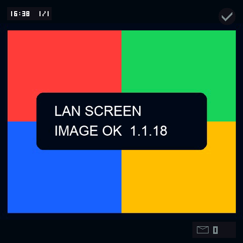
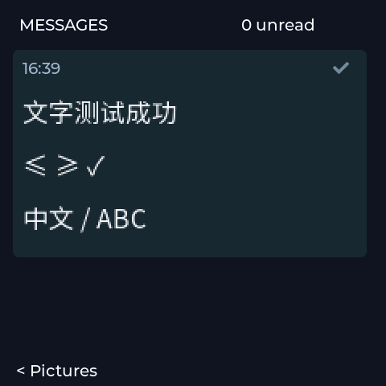
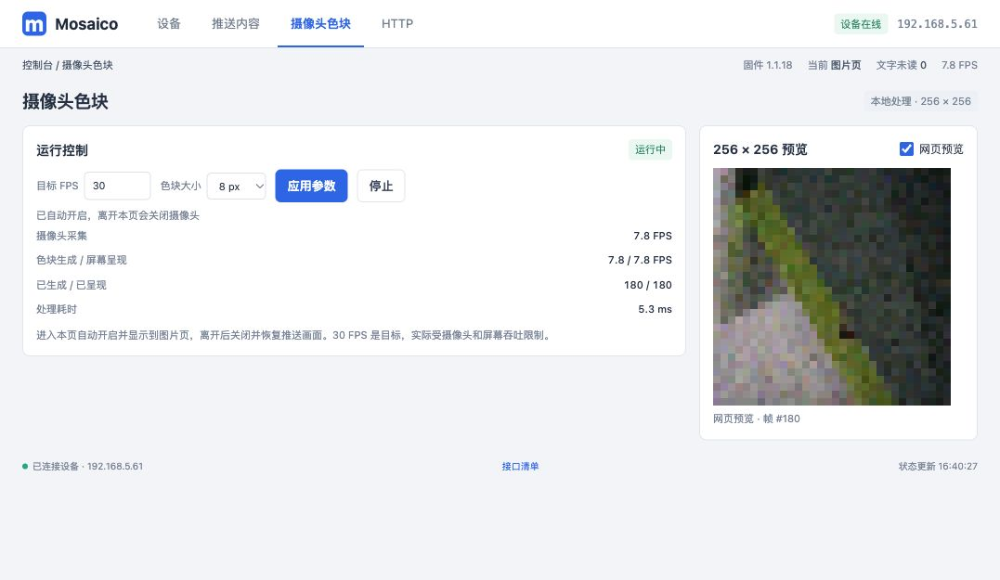

# 图片、文字、摄像头功能测试与1.1.18交付

2026-10-04，用户针对本轮明确要求测试三个功能页，并要求摄像头进入页面自动开启、离开关闭。只在本轮执行实际浏览器交互、推送内容、摄像头采集、REST查询及官方Iris截图；没有新增测试代码、单元测试或模拟器。此授权不延续到后续任务。

## 结果

实际访问设备 http://192.168.5.61，未使用本地Mock页面。最终检查均针对已安装的1.1.18。

| 功能 | 操作与实际结果 |
| --- | --- |
| 图片 | 在网页粘贴640×520测试PNG，浏览器转换为480×480、16.9KiB JPEG；发送后WS返回“已接收 #1 · 19 ms”。设备received=1/displayed=1、dropped=0/invalid=0；真实屏幕截图显示测试图案。此轮覆盖粘贴流程，没有完成系统文件选择对话框的验证。 |
| 文字 | 网页发送“文字测试成功\n≤ ≥ ✓\n中文 / ABC”，32px、左对齐、16:39。设备自动切到文字页，截图显示中文、英文及符号，历史read=true、message_unread=0。自动切换保持设备原有true配置。 |
| 摄像头 | 点击摄像头功能导航即自动采集和开启网页预览，不需要点击启动按钮。设备本地处理并显示256×256色块；预览接口HTTP200、131072字节RGB565_BE、256×256，实际场景非空白。 |
| 离开 | 导航到设备页后camera及render均disabled，requested_enabled/enabled/valid均false，屏幕恢复推送图片。 |
| 重入与快速切页 | 重新进入恢复真实出帧；快速“推送内容→摄像头”后最终running、request_id=applied_request_id=5，生成和呈现计数持续增加。 |
| 关闭标签页 | 关闭代理创建的测试标签页后camera及render均disabled，request_id=applied_request_id=6，结束时摄像头和麦克风均关闭。用户原有标签页没有被关闭。 |

实现也处理visibilitychange：隐藏页面发送停止，回到可见的摄像头路由重新开启。本轮没有单独验证后台标签页隐藏/恢复事件；上述导航和关闭标签页已实测。

摄像头当前SC101IOT实际格式1280×720 UYVY、单采集缓冲，驱动报告sensor_fps=15。目标仍可配置1–30FPS，本轮生成/实际LCD呈现约7.8FPS，**未达到30FPS**。这是一轮功能检查的运行状态读数，不是持续性能基准；触屏滚动、全部旋转角度及传感器校准不属于本轮验收。

## 本轮发现并修复

- 摄像头运行时预览额外申请128KiB返回HTTP500“No preview buffer”。改为复用主HTTP服务已有256KiB接收缓冲，复制稳定帧后响应；最终预览返回200。
- 初次屏幕截图中≤、≥、✓为缺字方块。沿用固定NotoSansCJKsc字库，加入数学符号和Dingbats范围；重新编译、安装后截图确认这三个符号正确显示。
- 新增页面生命周期控制，启动/停止请求串行处理并以最新意图为准；页面退出使用keepalive停止请求，避免关闭页面后请求被通用取消逻辑中断。

## 编译与安装证据

固定ESP-IDF `7b9cc1ac79f865983f59bb8ff3ff43eb74ff1dbe`，esp32s31。最终低噪声构建`20261004-163629-build-97973`成功，应用BIN 4,946,352字节。官方app-update走normal→Vibe→normal，operation `bed4ffec-cd02-4176-aa38-baca4622f878` succeeded，healthy=true。

- Device ID：`4553502d4952495301001c2904d0ad2a`
- 当前版本：1.1.18，firmware_mode=normal，lifecycle_state=2，stale=false，crash_count=0。
- Boot ID：`6311375769310009455`。
- ELF/设备firmware_sha256：`cb04e96189809c9e975f11e4ceb6a11d9bcd3f2d5a17df39cc1b0458bdca783a`。
- BIN SHA256：`25b8d7d9b6a72c1f86be31b692a0f71b503df865e67d1e14f471c01fe43b5ac7`。

源码逻辑提交：`9f22ea9`页面生命周期，`379f162`预览缓冲复用，`a48ec83`符号字库。原始构建/安装日志、完整REST结果及原始色块帧保留于被忽略的`vendor/esp-mosaico-vibe/projects/lan_screen/.codex-runs/functional-pages-1.1.18/`；源码提交后仍按项目要求刷新根Git bundle。

## 真实截图

图片设备截图：

文字设备截图：

摄像头真实网页预览与运行状态：

停止后的设备截图恢复图片；其余截图及首次失败证据同目录保留。
